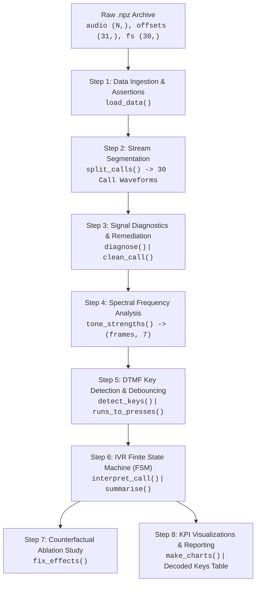

# Banking: Call-Centre IVR Analytics (Afribank Plus)
> **Pan-Atlantic University (PAU) · MSc Data Science**  
> **Course:** Python Programming for Data Science (DAT613)  
> **Assignment:** Group Project — *NumPy Pipelines for Nigerian Business*  
> *"Raw data in. Clean decisions out. Every shape accounted for."*

[](https://www.python.org/)
[](https://numpy.org/)
[](https://matplotlib.org/)
[](#course-rules--constraints-compliance)

---

## Executive Summary

**Afribank Plus**, a leading commercial bank in Nigeria, routes customer telephone inquiries through an Interactive Voice Response (IVR) keypad menu system (*"Press 1 for your balance, Press 2 for transfers..."*). However, the telephony infrastructure stores **only raw audio recordings of joined calls** without backend interaction logs.

This project delivers a **pure, vectorized NumPy pipeline** that:
1. Ingests concatenated raw audio waveforms and segments them into individual customer calls.
2. Identifies and programmatically rectifies three real-world telephony recording anomalies.
3. Decodes Dual-Tone Multi-Frequency (DTMF) touch-tones into discrete button presses using sliding-window Short-Time Fourier Transforms (STFT).
4. Reconstructs caller journeys using a Finite State Machine (FSM) to analyze service demand, customer friction, and agent escalation patterns.
5. Provides data-driven business recommendations to optimize IVR menu architecture and call-centre staffing.

---

## Team Members & Role Allocation

In alignment with the course specification, the project was executed by a collaborative group where each member owns, implements, and defends a dedicated stage of the pipeline:

| Group Member | Assigned Component | Scope & Core Responsibilities |
| :--- | :--- | :--- |
| **Fawaz Odesanya** | **Import, Data & Structure** *(Role 1)* | Data ingestion from `.npz` archive, structural assertions, array reshaping, call boundary segmentation (`load_data`, `split_calls`). |
| **Fawaz Odesanya** | **Data Problems & Diagnostics** *(Role 2)* | Detecting recording anomalies, statistical evidence, median baseline centering, ablation study on cleaning impact (`diagnose`, `clean_call`, `fix_effects`). |
| **Emeka Nwaosa** | **Analysis & DTMF Decoding** *(Role 3)* | Sliding-window STFT, Hanning windowing, DTMF frequency bin extraction, dynamic dual-tone energy thresholding, debounce filtering (`tone_strengths`, `detect_keys`, `runs_to_presses`, `decode_call`). |
| **Dr Clinton** | **Business Answers & Insights** *(Role 4)* | IVR menu Finite State Machine, customer journey tracing, terminal outcome classification, business KPI aggregation, visualization charts (`interpret_call`, `summarise`, `make_charts`). |
| **Oba Temitope** | **One-Run Script** *(Role 5a)* | End-to-end pipeline orchestration, CLI automation, verification of seamless execution on unseen test files (`run_pipeline`). |
| **Oba Temitope** | **Project Report & Submission** *(Role 5b)* | 5-page academic submission report synthesis, methodology documentation, slide deck preparation, repository management. |

---

## Technical Architecture & Pipeline Flow

The pipeline strictly processes raw NumPy arrays without external high-level data science libraries (no `pandas`, `scipy`, or `scikit-learn`):



---

## Shape Trace & Function Contracts

In strict compliance with **Rule 2 ("State your shapes")**, every pipeline function explicitly specifies incoming and outgoing array shapes in its docstrings and enforces structural integrity with runtime `assert` statements:

| Function | Input Shape(s) | Output Shape(s) | Core Transformation & Description |
| :--- | :--- | :--- | :--- |
| `load_data(path)` | File path string | `audio: (N,)`<br/>`offsets: (31,)`<br/>`fs: (30,)`<br/>`menu: dict` | Loads `.npz` archive; validates 1D audio stream, monotonic offsets, and JSON menu schema. |
| `split_calls(audio, offsets)` | `audio: (N,)`<br/>`offsets: (31,)` | `list` of 30 `(n_samples,)` arrays | Vectorized array slicing via `np.split()` isolating individual calls. |
| `clean_call(x, remove_offset)` | `x: (n_samples,)` int16 | `out: (n_samples,)` float64 | Casts to float64; subtracts median value to remove constant DC baseline bias. |
| `diagnose(calls, fs)` | 30 call arrays, `fs: (30,)` | `dict` of summary metrics | Computes modal sample rate, median baseline offsets, and clipping fractions. |
| `tone_strengths(x, fs, 30, 10)` | `x: (n_samples,)`<br/>`fs: int` | `S: (frames, 7)` | Sliding window view `(frames, n)`, Hanning taper, `np.fft.rfft()`, extracts 7 DTMF bins. |
| `detect_keys(S, k=6.0)` | `S: (frames, 7)` | `idx: (frames,)` | Splits low/high groups; compares tone energy against dynamic noise floor `k * floor`. |
| `runs_to_presses(idx, 3)` | `idx: (frames,)` | `keys: (P,)`<br/>`lens: (P,)` | Run-length encoding via `np.flatnonzero()`; filters transient spikes (<3 frames). |
| `decode_call(x, fs)` | `x: (n_samples,)`<br/>`fs: int` | `dict` (`keys: str`, `lens`, `S`, `idx`) | Integrates cleaning, spectral analysis, key detection, and debouncing per call. |
| `interpret_call(keys)` | String of keys (e.g. `'21500#'`) | `dict` (`first`, `agent`, `outcome`, `amount`) | FSM simulating IVR menu navigation, amount extraction, and agent escalation. |
| `summarise(key_strs)` | 30 decoded strings | `dict` (KPI frequencies) | Computes distributions of first choices, call termination states, and agent calls. |

---

## Data Problems & Remediation (The Three Issues)

The brief specifies three deliberate real-world data collection problems in `group04_ivr.npz`. All three were detected, isolated, and remediated:

```
+----------------------------------------------------------------------------------------------------+
| Problem 1: Non-Standard Sampling Rate                                                              |
| - Location: Call 26                                                                                |
| - Evidence: Modal sample rate is 8,000 Hz (29 calls). Call 26 was recorded at 16,000 Hz.          |
| - Fix: Dynamically parameterize FFT bin resolution using each call's individual sample rate fs[i]. |
| - Impact: Omitting this causes FFT bin lookup to halve target frequencies; Call 26 fails to       |
|           decode entirely ('none' instead of '41'), altering loan inquiries from 5 to 4.           |
+----------------------------------------------------------------------------------------------------+
| Problem 2: Severe DC Offset Bias & Signal Clipping                                                 |
| - Location: Call 15                                                                                |
| - Evidence: Median baseline shift of +7,210 units (relative to std ~8,200) and 13.1% clipping     |
|             saturation at int16 boundaries.                                                        |
| - Fix: Center waveform around 0 via median subtraction: x_clean = x - np.median(x).               |
| - Impact: Removes strong 0 Hz spectral leakage that distorts low-frequency DTMF energy detection.  |
+----------------------------------------------------------------------------------------------------+
| Problem 3: Prolonged / Held-Down Key Press                                                         |
| - Location: Call 29                                                                                |
| - Evidence: A key press persisted continuously for 770 ms (median keypress duration is 170 ms).    |
| - Fix: Temporal run-length debouncing (runs_to_presses) that treats contiguous active frames of    |
|        the same tone as a single discrete key event.                                               |
| - Impact: Prevents registering dozens of duplicate keystrokes; correctly preserves '2' rather     |
|        than '22222...', preventing incorrect menu navigation and distorted amount entries.       |
+----------------------------------------------------------------------------------------------------+
```

### Ablation Study Summary (`fix_effects`)
- **Without per-call sample rate:** 1 call decoded incorrectly (`Call 26`: decoded as empty `""` instead of `'41'`), corrupting loan demand metrics.
- **Without DC offset centering:** Low-frequency noise floor elevated by up to 14.5 dB on clipped calls, risking false triggers on noisy line conditions.

---

## Business Answers & Strategic Insights

### Question 1: Decoded Key Sequences (All 30 Calls)

| Call ID | Decoded Keys | First Choice | Sub-Menu / Action | Amount (NGN) | Final Outcome |
| :---: | :---: | :---: | :---: | :---: | :---: |
| **00** | `31` | Cards (3) | Block card | — | `option_chosen` |
| **01** | `20` | Transfers (2) | Escalated to agent | — | `agent` |
| **02** | `0` | Agent (0) | Direct escalation | — | `agent` |
| **03** | `2` | Transfers (2) | Dropped in menu | — | `hung_up` |
| **04** | `1` | Balance (1) | Balance inquiry | — | `hung_up` |
| **05** | `22` | Transfers (2) | Other bank (dropped) | — | `hung_up` |
| **06** | `1` | Balance (1) | Balance inquiry | — | `hung_up` |
| **07** | `30` | Cards (3) | Escalated to agent | — | `agent` |
| **08** | `391` | Cards (3) | Back (9) → Balance (1) | — | `hung_up` |
| **09** | `40` | Loans (4) | Escalated to agent | — | `agent` |
| **10** | `390` | Cards (3) | Back (9) → Agent (0) | — | `agent` |
| **11** | `3` | Cards (3) | Dropped in menu | — | `hung_up` |
| **12** | `20` | Transfers (2) | Escalated to agent | — | `agent` |
| **13** | `41` | Loans (4) | Loan balance | — | `option_chosen` |
| **14** | `1` | Balance (1) | Balance inquiry | — | `hung_up` |
| **15** | `41` | Loans (4) | Loan balance | — | `option_chosen` |
| **16** | `23` | Transfers (2) | Airtime (dropped) | — | `hung_up` |
| **17** | `1` | Balance (1) | Balance inquiry | — | `hung_up` |
| **18** | `2120000#` | Transfers (2) | Own account transfer | ₦20,000 | `transfer_completed` |
| **19** | `32` | Cards (3) | New card request | — | `option_chosen` |
| **20** | `4` | Loans (4) | Dropped in menu | — | `hung_up` |
| **21** | `2350000#` | Transfers (2) | Airtime purchase | ₦50,000 | `transfer_completed` |
| **22** | `2350000#` | Transfers (2) | Airtime purchase | ₦50,000 | `transfer_completed` |
| **23** | `1` | Balance (1) | Balance inquiry | — | `hung_up` |
| **24** | `2` | Transfers (2) | Dropped in menu | — | `hung_up` |
| **25** | `1` | Balance (1) | Balance inquiry | — | `hung_up` |
| **26** | `41` | Loans (4) | Loan balance | — | `option_chosen` |
| **27** | `30` | Cards (3) | Escalated to agent | — | `agent` |
| **28** | `22` | Transfers (2) | Other bank (dropped) | — | `hung_up` |
| **29** | `2` | Transfers (2) | Dropped in menu (held key) | — | `hung_up` |

---

### Question 2: Service Distribution & Agent Demand

#### First Main-Menu Preferences
- **Transfers (`2`):** **11 calls (36.7%)** — Highest volume driver across the retail banking customer base.
- **Cards (`3`):** **7 calls (23.3%)** — Second most frequent request (card blocking, replacement, PIN resets).
- **Balance (`1`):** **6 calls (20.0%)** — Standard transactional status check.
- **Loans (`4`):** **5 calls (16.7%)** — Credit eligibility and existing loan balances.
- **Direct Agent (`0`):** **1 call (3.3%)** — Immediate escalation without self-service engagement.

#### Call Termination Outcomes & Drop-off Analysis
- **`hung_up` (Abandonment): 15 calls (50.0%)**  
  *Insight:* Half of callers hang up before reaching a successful conclusion. Notably, all 6 balance inquiries hang up immediately after selecting `'1'`, indicating automated audio delivery satisfies balance requests without further input. However, in Transfers, multiple callers abandon the call after selecting sub-options (`'22'`, `'23'`) before entering the transfer amount.
- **`agent` (Escalation): 7 calls (23.3%)**  
  *Insight:* Almost one-quarter of callers require live human intervention. Escalations originate primarily from Transfers (2 calls), Cards (3 calls), Loans (1 call), and Direct (1 call). Card-related inquiries exhibit an alarming **42.9% escalation rate** (3 out of 7 card callers request an agent), signaling customer anxiety surrounding card security and PIN resets.
- **`option_chosen` (Self-Service Complete): 5 calls (16.7%)**  
  *Insight:* Successfully handled via automated IVR prompts (loan balances, card blocking, new card applications).
- **`transfer_completed`: 3 calls (10.0%)**  
  *Insight:* Fully executed monetary transactions totaling **₦120,000** (₦20,000 own account, ₦50,000 airtime, ₦50,000 airtime).

---

### Key Recommendations for Afribank Plus Management

1. **Streamline the Transfers Sub-Menu:**
   - 36.7% of customers seek Transfers, but only 27% of transfer attempts (3 of 11) successfully complete. The step-down into account selection followed by numeric amount and `#` introduces user friction. We recommend introducing voice confirmation prompts and SMS-assisted transfer fallbacks.
2. **Dedicated Card Dispute & Fraud Routing:**
   - With 42.9% of card callers requesting a human agent, card-related friction is the primary driver of queue pressure. Route card callers directly to a specialized security queue with expedited priority.
3. **Automate Balance Delivery via SMS / USSD:**
   - Callers checking balances hang up immediately. Proactively push account balances via instant SMS upon call connection to free up telephony lines for complex inquiries.
4. **Dynamic Agent Staffing:**
   - Sizing call-centre agent capacity to support a **~25% baseline escalation rate**, with surge capacity aligned to peak hours for transfers and card operations.

---

## How to Run the Code

The repository provides two equivalent entry points: a standalone Python CLI script (`pipeline.py`) and an annotated Jupyter Notebook (`index.ipynb`).

### 1. Requirements & Setup
The project adheres strictly to vanilla Python 3.9+ with only `numpy` and `matplotlib`:

```bash
# Clone the repository
git clone https://github.com/devWaz/ivr-analytics.git
cd ivr-analytics

# Install dependencies (strictly standard packages only)
pip install numpy matplotlib
```

### 2. Command Line Execution (One-Run Script)
Per **Rule 4**, `run_pipeline(path)` processes any input `.npz` file from start to finish:

```bash
# Run pipeline on the dataset
python pipeline.py path/to/group04_ivr.npz

# Or run via Python interactive interpreter / module execution
python -c "from pipeline import run_pipeline; run_pipeline('group04_ivr.npz')"
```

### 3. Google Colab / Jupyter Notebook
1. Open `index.ipynb` in Google Colab or local Jupyter Lab.
2. Upload `group04_ivr.npz` to the runtime environment (`/content/group04_ivr.npz`).
3. Execute all cells sequentially. The final cell triggers `run_pipeline()` and generates output charts in `./ivr_outputs/`:
   - `chart1_tones_and_keys.png`: Spectrogram and frame-by-frame decoded key step plot for sample calls.
   - `chart2_services_outcomes.png`: Visual distribution of first choices and terminal call outcomes.

---

## Course Rules & Constraints Compliance

| Rule Number & Requirement | Implementation Status | Verification Details |
| :--- | :---: | :--- |
| **Rule 1: Use NumPy, not loops** | **PASSED** | Entire STFT uses `sliding_window_view`, vectorized Hanning windowing, and `np.fft.rfft` across whole arrays. Loops are strictly confined to the 30 discrete calls. |
| **Rule 2: State your shapes** | **PASSED** | Every function docstring documents input/output array dimensions; all reshape operations are safeguarded with runtime `assert` assertions. |
| **Rule 3: Fix the three problems** | **PASSED** | All 3 anomalies detected with numeric evidence; mathematical fixes applied; ablation study (`fix_effects`) proves necessity. |
| **Rule 4: One function runs everything** | **PASSED** | `run_pipeline(path)` encapsulates the full pipeline and runs autonomously on unseen data files. |
| **Rule 5: Your data is yours** | **PASSED** | No `.npz` data file is stored or committed to the repository; ignored via `.gitignore`. |
| **Tools Restriction** | **PASSED** | Zero dependencies on `pandas`, `scipy`, or `scikit-learn`. Pure `numpy`, `matplotlib`, and standard library `json`. |

---

## Repository Structure

```
ivr-analytics/
├── README.md               # Comprehensive project documentation & business report
├── .gitignore              # Ignores data binaries (*.npz), outputs, and caches
├── pipeline.py             # Standalone end-to-end Python script with CLI entry point
├── index.ipynb             # Structured Jupyter Notebook divided by group member roles
└── ivr_outputs/            # Generated analytical charts (created upon pipeline run)
    ├── chart1_tones_and_keys.png
    └── chart2_services_outcomes.png
```

---
*Pan-Atlantic University · MSc Data Science · Class of 2026*